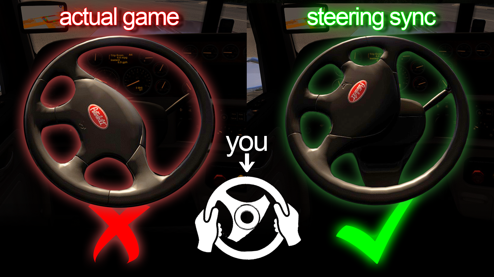

# steeringsync
American Truck Simulator and Euro Truck Simulator 2 steering animation fix

Made in version 1.61

TLDR: This DLL plugin overrides the steering animation to directly follow your own device's directinput.
It basically overrides the "non-linearity" setting visually, so that it does not slow down your steering animation ingame near the center anymore.

**INSTALLATION**

**DLL goes here:
\American Truck Simulator\bin\win_x64\plugins**

**If you don't know how to access American Truck Simulator's root folder,
Right click American Truck Simulator in your Steam library list -> Manage -> Browse local files**

**If you don't have a "plugins" folder, simply create one.**

I generally use from 50 to 100% of non-linearity personally (I like to drive old more floaty trucks), 100% sensitivity, 0% deadzone.

Why not a Steam workshop mod? 
I wish. Except this is a deeper edit of the game that is simply not possible to publish on Steam.

**You like to read?**

Trucks and cars in American Truck Simulator have way too much sensibility at the center of the steering position. 
Turning your steering wheel a ridiculous 2 degrees should not make you swerve off your lane. 
It results in too high of a focus of your position on the road, which makes reading useful cabin informations much harder than it should be. 
This is certainly not how it works in real life for most trucks or cars.

So naturally, in order to counter that exact issue.. you changed the ingame setting "steering non-linearity".
Except this setting is just badly programmed. 
It changes your force feedback (and that is logical -but it's also badly made, anyway-),
and also changes your steering animation.

Given that it changes your device input curve instead of physically simulating a different steering ratio, 
and as the steering animation simply follows that given input curve, the result is:
you turn your own device's steering wheel X amount of degrees, and ingame it turns visually way less than that.
Given that I like to drive old petes, and the new mustang, I push the non linearity a little bit further, so it exacerbates the issue.

So this DLL plugin is supposed to address a part of the issue: the visual part.
What it does not solve is the actual lack of force feedback you will feel at the center, and the feeling of it being less "natural".

That's another issue and it's way, way harder to solve. 
I might try to tweak around and see, but given that I already failed many tweaks of this physics engine... yeah.. we'll see.

Honestly I just think that addressing this from the official devs is really overdue.
How a truck or car behaves in a "simulator" is a core fundamental of the game. But hey, maybe it's me, maybe I'm too used to Assetto Corsa, Iracing...

The part that still surprises me is this- this issue is well known, and all these 14 whole years since ETS2 came out.. nobody fixed it. (at least publicly...)

**DISCLAIMER: this mod has been vibecoded. I know, it's not ideal, but if you really know what you're doing, feel free to properly remake this.**

DISCLAIMER 2: If your anti-virus flags this file... consider changing it.

DISCLAIMER 3: this is a pre-pre-pre-alpha. Maybe it won't work as intended, or recognize your specific wheel- I need to do extensive testing. I only have a T500RS.

This plugin is under the PolyForm Noncommercial 1.0.0 license. 
Which means you can freely reuse, edit, do whatever you want, exept make money with it.
https://polyformproject.org/licenses/noncommercial/1.0.0
